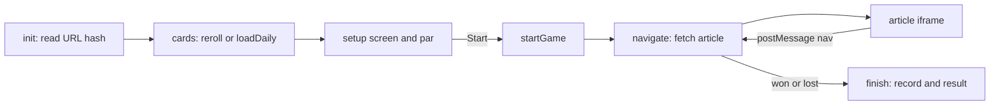

# How it works

An overview of the code for a developer new to the repo. The game is one `index.html` with no build step and no dependencies, plus data files generated from an offline copy of the wiki. Articles, pictures and descriptions come live from minecraft.wiki's API while you play.
The game's terms (pool, Content, hubs, par) are explained in [how-to-play.md](how-to-play.md).
To run it, open `index.html` in a browser; [development.md](development.md) has the tests and the rest of the workflow.

## The files

| File | What it is for |
| --- | --- |
| `index.html` | The whole game: markup, CSS and script, all inline. |
| `wiki-data.js` | `WIKI_DATA`: every article with its link counts, topic, Content and tiers, plus the hubs, left-out pages, namespaces, spin-offs, Scavenger's kinds and the snapshot's date. Loaded with a script tag. |
| `wiki-links.js` | The link graph: each page's links outside navboxes, for par and route searches. |
| `wiki-navboxes.js` | Each navbox once and the pages that carry it, added to the graph in Relaxed. |
| `wiki-lead.js` | Each page's links above its first heading, the graph for Top links only. |
| `minecraft.wiki_en_all_*.zim.sha256` | The checksum of the Kiwix ZIM the four data files were built from (the ZIM itself isn't in the repo). |
| `favicon.ico`, `apple-touch-icon.png`, `og-image.png` | The icon and the link-preview image. |
| `tools/wikidata/` | The Python scripts that build the four data files from the ZIM, their `config.json`, and `RESEARCH.md` with the numbers behind the difficulties and pools. |
| `tools/check-docs.mjs` | Checks the docs' links and that the names the internal docs mention are still in the code (see [the docs check](development.md#the-docs-check)); `check-docs.test.mjs` tests it. |
| `test/` | `run-e2e.sh` runs `e2e.mjs` (real games on the live wiki) or `offline.mjs` (the game's logic, every request answered by the test) in headless Firefox, both driving it through `harness.mjs`. |
| `.githooks/pre-commit` | Runs the docs check, then the offline suite unless the commit has only docs, pictures or `tools/`. |
| `docs/` | These pages; `docs/internal/` is the detailed reference, one file per part of the game. |
| `README.md`, `LICENSE`, `CLAUDE.md` | The introduction, the MIT licence, and instructions for AI coding agents. |

The data files are generated, never edited by hand: [wiki-data.md](wiki-data.md) explains how.

## Inside index.html

The file goes, top to bottom:

1. `<head>`: the meta description, Open Graph tags, the canonical link to mcwikirace.com, and one `<style>` with all the CSS. Colours and fonts are CSS variables on `:root`, which is what a theme changes.
2. The theme boot script (`#theme-boot`), first thing in `<body>`. It applies the saved theme before the first paint, so the page never flashes the wrong colours.
3. The markup: the background canvas, the setup screen (`#setup`), the footer, the game screen (`#game`, with the article iframe `#frame`), the modal (`#modal`, shared by the result and every other dialog) and the effects canvas (`#fx`).
4. `<script src="wiki-data.js">`, then the main script, which is the rest of the file.

The main script is split into sections by `// ----` banner comments, in this order:

| Section | What is in it |
| --- | --- |
| (top) | Constants read from `WIKI_DATA`, `TOPICS`, `REACHES`, small helpers, the `store` wrapper and the record checks. |
| API helpers | `api()`, `pageInfo`, the groups rolls draw from. |
| Setup screen | `RULES`, `GAMES`, `EXTRA_RULES`, `LEVELS`, Content, the cards, `reroll`. |
| Daily challenge | `hash32`, `dailyPair`, `loadDaily`, sealed challenge links, Recent games. |
| Game | The `game` object, the header, `startGame`, the parse cache, `navigate`, `frameReady`. |
| Sounds, Effects | Sounds from the wiki, sparks, Distance's cheer, Reduce motion. |
| Advancements, Items, Note block | Advancements and XP, the hotbar of items and fireworks, the note block picker. |
| Themes | Themes, then `renderArticle`, which holds the article frame's script, and the listener for its messages. |
| Par | The link graph, route searches, Distance, and the result window (`finish`). |
| Background, Modal, Wiring | The setup screen's background, dialogs, event listeners, and `init` at the very end. |

## From opening the page to a result

1. The browser loads `index.html` and `wiki-data.js`; the theme boot script applies the theme.
2. `init` reads the URL hash: a challenge link, a daily, or nothing. It fills the cards from the link, with `loadDaily`, or by rolling them with `reroll`. Each card is looked up live (`pageInfo`) for its description and picture.
3. Once the cards are in, the link graph, loading since the page opened, gives par: the setup screen finds a shortest route and shows it beside Start.
4. Start calls `startGame`, which copies the setup and the rules into `game` and navigates to the start article.
5. `navigate` fetches the article, adds it to the path (noting a checkpoint or a find), writes it into the article iframe, then checks for a win or a loss, which goes straight to `finish`.
6. The frame classifies its links and posts `ready`; `frameReady` hides the loading overlay and resumes the clock.
7. A click on a live link posts a message to the page, which calls `navigate` again.
8. A win, a loss or Give up calls `finish`, which saves the record and opens the result window. Par and the shortest route fill in once known.

## Fetching articles

Every request to the wiki's MediaWiki API goes through `api()`. It adds `origin=*`, keeps at most four requests in flight with the rest queued in order (MediaWiki asks clients not to send many at once), and times each out after 30 seconds. Most requests are `pageInfo`, for a card's description, picture and redirects, or `action=parse`, for an article's HTML. The rest look up the addresses of the wiki's pictures and sounds once each, when first needed.
Nothing polls: every request comes from something the player did.

The parse cache keeps up to 40 titles (an article is kept under both the requested and the resolved title) and at most 10 million characters, so Back and Same cards again don't fetch again. The API marks parse replies uncacheable, so the browser's own cache can't do this.
When a link is pressed with a mouse or pen, the frame says so and the article is asked for at once, a little before the click arrives.

Details: [internal/rendering.md](internal/rendering.md#api-access), [internal/rules.md](internal/rules.md#the-parse-cache)

## Showing articles

Each article is written with `srcdoc` into a sandboxed iframe (`sandbox="allow-scripts"`, so it gets an opaque origin). That lets the wiki's own stylesheets apply untouched without leaking into the game, and a `<base href>` makes the wiki's relative image and CSS addresses work without rewriting.
`renderArticle` builds a script into the frame with what it needs to know: the dead namespaces, the left-out pages, the titles the rules block (hubs under No hubs, pages already passed under Exact clicks or on a round trip's way back), the pages already visited, the theme.

That script classifies every link. A link to an article in play is live (`mwr-live`), and also `mwr-seen` if you have already been there. Everything else is dead (`mwr-dead`): other namespaces (but a spin-off that is on), red links, external links, the left-out version and list pages, and whatever the rules switch off (navbox links, hubs, links below the first heading, pages already passed under Exact clicks or on a round trip's way back).
A click on a live link posts `{mwr:'nav', title, …}` to the page and a dead one `{mwr:'dead'}`; once the stylesheets have loaded, a separate script posts `ready` with how many live links there were. The frame script also copies what the wiki's own JavaScript does for articles: animated crafting grids, tabs, folding boxes, layered blueprints, sounds and tooltips. The calculators (a breaking-time table's Efficiency and Haste sliders, mob damage, food) are the one exception: on a page with them, the frame loads the wiki's own calculator script, with jQuery, from the wiki.

Details: [internal/rendering.md](internal/rendering.md#rendering-articles)

## Picking the cards

Rolls draw titles from `wiki-data.js`:

- Groups: each card draws a group first, then a title in it: the five topics, plus one group for each Content family or spin-off that is on, so a small topic comes up as often as a big one. In the pool modes the start and target never share a topic, since a topic's navbox would put them one click apart. Chaos draws every page alike: every article, plus the pages of each spin-off that is on.
- Pools: the pool (Popular, Everyday, Deep cuts or Chaos) decides which titles the groups hold, and a target must be linked from enough articles outside navboxes that No navboxes can still reach it.
- The web of links: every rolled card must join it under the game's settings. A start needs a route to the best-linked article that isn't a hub (Lava), a target a route from it, and a checkpoint both. One search each way answers that for every page at once.
- Target par: with one chosen, the start is rolled first, from those with a target at that par, then the target from those at the par from it. Which pars each start has is worked out for every start at once and cached per settings.

The daily uses rendezvous hashing: every title is ranked by `hash32` of the date, a salt and the title, and the lowest-ranked one that passes the checks wins. The day's rule is ranked the same way, and a target is only taken if the link graph has a route under that rule, so every daily can be done.

Details: [internal/picking.md](internal/picking.md)

## Challenge links

Copy challenge link puts the setup into the URL hash as `g=`: the cards and the rules, packed into bytes and scrambled so the cards aren't readable at a glance. The key is in the page, so this hides rather than protects; a made-up link can do nothing a plain one can't. Titles go in as text, so a link still opens the same game after a snapshot update.
Plain `start=`, `target=`, `via=` and `rules=` keys work too, which is handy for testing a route.
`g=` is the first format of these links. A later release whose links this one would misread puts them under `g2=` and so on, and this release, met with one in a page cached or left open, rolls new cards and asks for a reload rather than open it wrongly.

Details: [internal/url-hash.md](internal/url-hash.md)

## Par and route searches

Par is the fewest clicks for a pair, worked out in the page by a breadth-first search over the link graph. `linkGraph` loads `wiki-links.js` as the page opens, adds `wiki-navboxes.js` in Relaxed or uses `wiki-lead.js` alone under Top links only, and refuses any file whose checksum doesn't match `wiki-data.js`.
The search follows the game's settings: hubs are dead in Hard, spin-off pages count only when on, and checkpoints split the route into legs. Round trips, Scavenger and Exact clicks each have a search of their own on the same graph.

The same searches drive Distance (how many clicks you are from what is next, measured at every arrival) and the result's missed shortcut. Live edits since the snapshot can make the real fewest clicks differ, so the result names the snapshot's date.

Details: [internal/par.md](internal/par.md#route-searches)

## Game state and rules

All state during play is in one object, `game`: the cards, the path, the Back stack, the clock, par, and `game.rules`, the rule keys copied from the setup screen at Start. The difficulty is two of those rules: Normal is No navboxes, and Hard adds No hubs.
The games (Relay, Scavenger hunt, Exact clicks) and the extra rules mostly work by changing what the objective is, which links are dead, or when the game ends.

The clock pauses while an article loads: `navigate` sets `game.loading` and `frameReady` clears it (as do a failed load and a win or loss), or a 15-second timeout if the frame never answers. Clicks during a load are ignored. Every navigation takes a new `navToken`, so a reply, `ready` message or timeout left over from an earlier navigation is thrown away. While a game is on, leaving the page asks first.

Details: [internal/rules.md](internal/rules.md)

## What's kept in the browser

Everything is kept in `localStorage`, through a `store` wrapper that swallows storage errors. Saved records are checked on the way back in (`isRecord`), since storage is shared with every page on the origin and open to the player.
The history, dailies and advancements are written back beside what the page can't read, and one stored in a shape it doesn't write is left alone, so a page left open from an older release doesn't wipe what a newer one saved. Neither they nor a link have a version marker yet: without one, it's the first format.

| Key | What it holds |
| --- | --- |
| `mwr.history` | The last 50 results, for Recent games and each pair's personal best. |
| `mwr.dailies` | Every daily played, by date, for the streak; kept apart so it outlasts the history. |
| `mwr.advancements` | The advancements earned, the XP, and the counts towards them. |
| `mwr.theme`, `mwr.sound`, `mwr.timer`, `mwr.effects`, `mwr.reduceMotion` | Theme, Sound, Timer, Effects and Reduce motion. |
| `mwr.noteBlock`, `mwr.pathCollapsed`, `mwr.background` | The note block's pick, whether the path sidebar is collapsed, the background's settings. |

Details: [internal/persistence.md](internal/persistence.md)

## The visual layer

Themes are sets of CSS variables, and a page hosting the game can add its own with a `data-mwr-theme` stylesheet; the article follows in the wiki's light or dark theme. Behind the setup screen a canvas draws the wiki as a constellation or a redstone map, worked out from `wiki-data.js` and the link graph. Sounds and pictures are Minecraft's own, fetched from the wiki.
Effects add sparks, fireworks and Distance's cheer, advancements and XP are earned across games, and the hotbar's items blow the page itself to pieces, which Rebuild puts back. Reduce motion stills everything that moves by itself.

Details: [internal/ui.md](internal/ui.md), [internal/advancements.md](internal/advancements.md), [internal/items.md](internal/items.md)

## Rules that break things quietly

None of these shows an error when broken: the game just stops working somewhere.

- Every API request goes through `api()`. It adds `origin=*`, without which MediaWiki sends no CORS header, and a page opened from `file://` fetches nothing.
- No HTML comment opener in the scripts. If `<!--` appears literally anywhere in `index.html`'s scripts, comments included, the HTML parser can run past the closing script tag and the page silently doesn't run. For the same reason, values written into the article frame's script go in as JSON with `<` escaped, since a link fragment can hold any text.
- During play and in `finish`, read `game.rules`, never the checkboxes. The boxes alone aren't the rules in play: `rules()` adds the difficulty's and leaves out a ticked box that is off with the game (Six clicks under Exact clicks or Top links only), and `startGame` settles that set once, so the result and the record match what was played.
- Everything in a navigation that can fail has to fail inside `navigate`'s `try`. That is where Retry and Cancel are offered; an error after it leaves the game loading for good, with Give up disabled.
- The data files come from the Kiwix ZIM only. `wiki-data.js` and the three graph files are generated by `tools/wikidata/`: never edit them by hand, and never update them by crawling the live wiki (see [wiki-data.md](wiki-data.md)).
